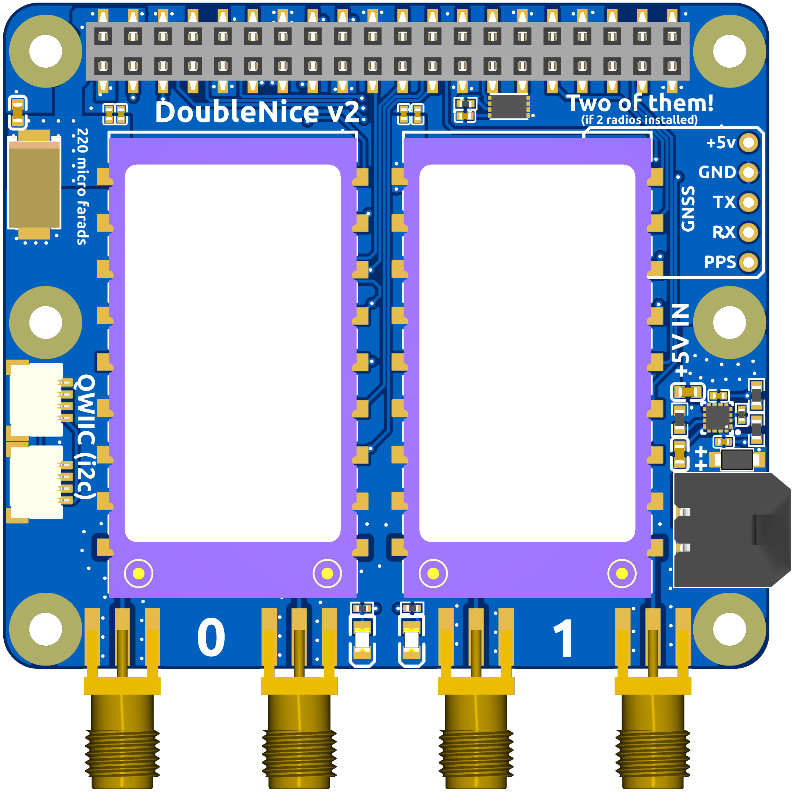
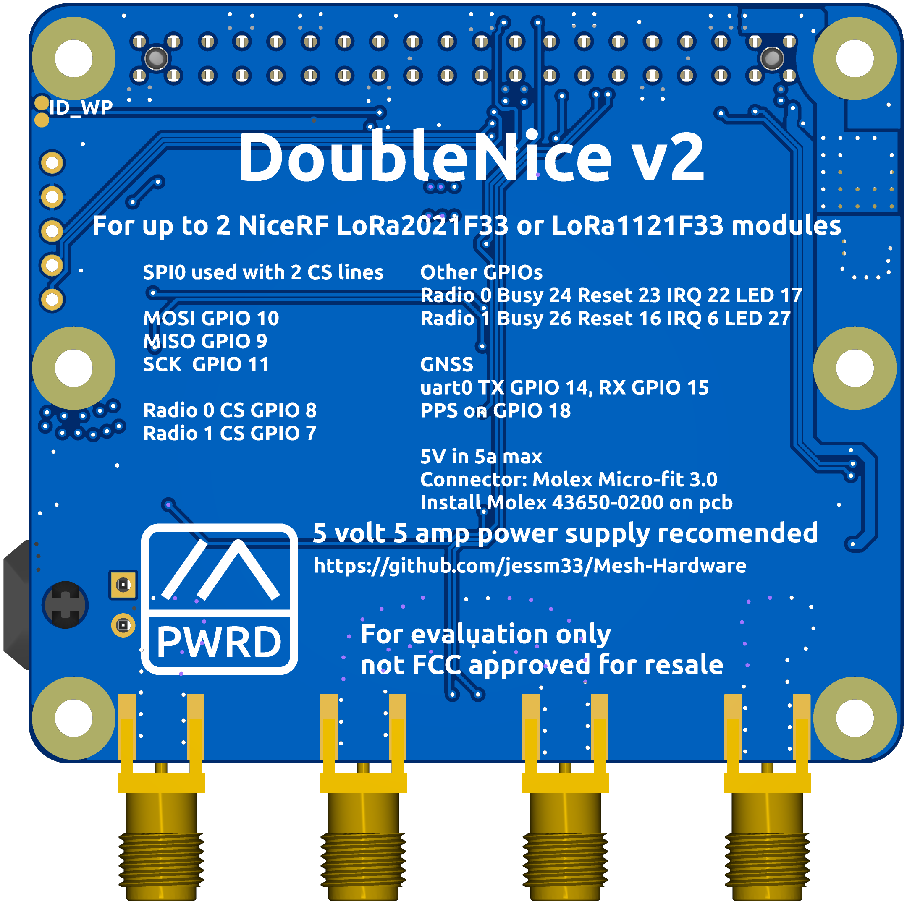

# Double Radio Pi Hat for NiceRF LR F33 Modules (v2)

This is a Raspberry Pi HAT for NiceRF 1–2 watt F33 LR1121 and LR2021 modules, featuring dual LoRa radios, GPS port, dual I2C QWIIC ports, a protected load sharing 5v input for both the hat and the pi, and a HAT+ compliant EEPROM.

> [!WARNING]
> **This v2 design has not yet been tested.** No boards have been built or validated. EEPROM image and Meshtastic radio config YAML files are not yet available — they are coming once the design has been verified.

> [!WARNING]
> **The LR2021 module is not supported in any official Meshtastic release.** A custom build of `meshtasticd` is required. 

---

## PCB

| Front | Rear |
|-------|------|
|  |  |

---

## Ordering PCBs from JLCPCB

### Files

| File | Purpose |
|------|---------|
| [Gerber_PCB1_2026-10-14.zip](Gerber_PCB1_2026-10-14.zip) | Gerber files for PCB fabrication |
| [BOM_Board1_PCB1_2026-10-14.csv](BOM_Board1_PCB1_2026-10-14.csv) | Bill of materials for JLCPCB SMT assembly |
| [PickAndPlace_PCB1_2026_10_14.csv](PickAndPlace_PCB1_2026_10_14.csv) | Component placement file for SMT assembly |
| [InteractiveBOM_PCB1_2026-10-14.html](InteractiveBOM_PCB1_2026-10-14.html) | Interactive BOM for visually identifying component placement |

### Steps

1. Go to [jlcpcb.com](https://jlcpcb.com) and click **Order Now**.
2. Upload `Gerber_PCB1_2026-10-14.zip`. JLCPCB will auto-detect the board dimensions.
3. Set your desired quantity and any stack-up/colour preferences (defaults are fine).
4. Enable **PCB Assembly (PCBA)** and select **Standard PCBA**.
5. Upload `BOM_Board1_PCB1_2026-10-14.csv` and `PickAndPlace_PCB1_2026_10_14.csv` when prompted.
6. Confirm component matches — all parts are sourced from LCSC and should resolve automatically.
7. Review the component placement preview, then proceed to checkout.

> **Note:** The NiceRF LR2021F33 / LR1121F33 radio modules are **not available at JLCPCB** and must be soldered by the end user. The modules use a castellated SMD footprint suitable for reflow on a hotplate. Order them directly from NiceRF or search for **"LR2021F33"** / **"LR1121F33"** on AliExpress.

---

## Flashing the HAT+ EEPROM

Not yet available. An EEPROM image will be added here once v2 has been tested.

---

## Radio Configuration

Not yet available. Meshtastic radio config YAML files will be added here once v2 has been tested.

---

## Schematic

[SCH_Schematic1_2026-10-14.pdf](SCH_Schematic1_2026-10-14.pdf)

---

## 3D Model

[3D_PCB1_2026-10-14.step](3D_PCB1_2026-10-14.step)

---

## Previous version (v1)

The original design has been moved to [v1/](v1/). **v1 is no longer recommended** — use v2 above instead.

---

## License

This work is licensed under the **[CERN Open Hardware Licence Version 2 - Strongly Reciprocal (CERN-OHL-S v2)](../../LICENSE.md)**.

You are free to use, study, modify, and distribute these designs and products made from them, provided that any Product embodying this Licensed Material — or Modifications of it — is made available under the same licence, with corresponding source made available per Section 5.
