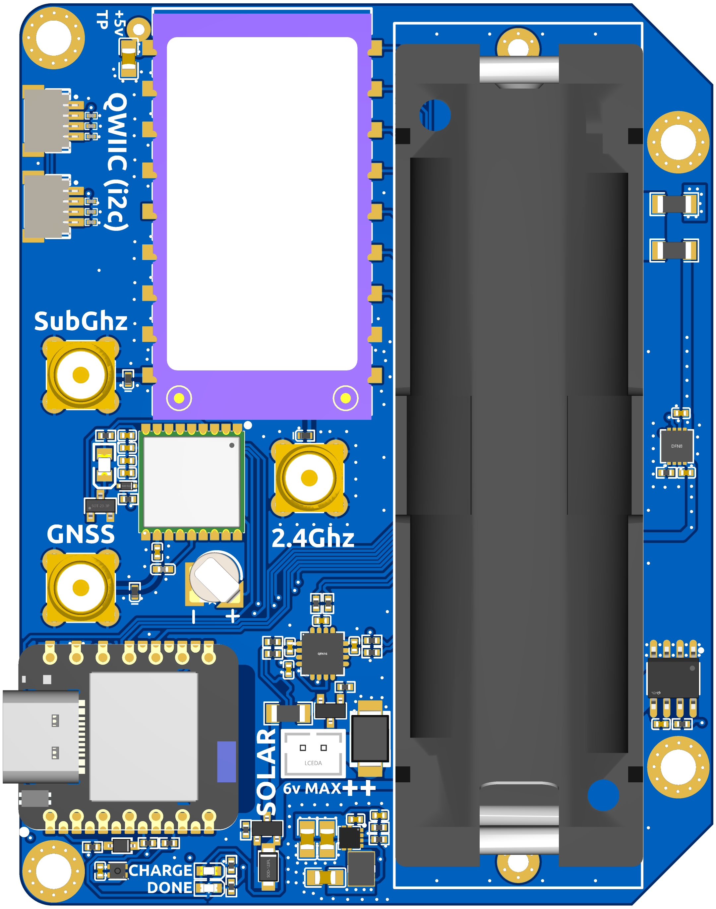
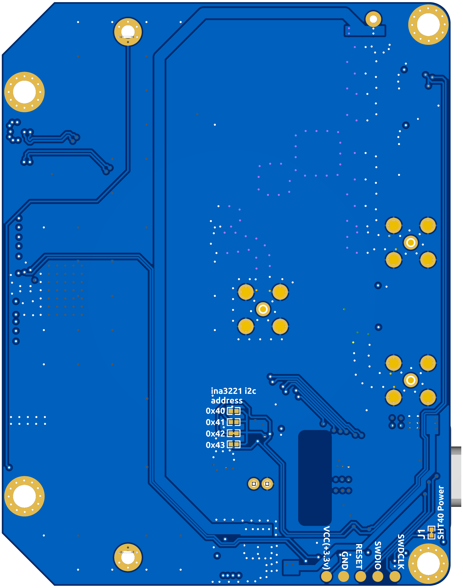

# nRF52840 + NiceRF 1W LR2021 Solar LoRa/GNSS Node

A standalone, solar-rechargeable LoRa sensor/tracker node built around a **Seeed XIAO nRF52840 Plus** MCU and an **NiceRF 1 W LR2021F33** module. The Semtech **LR2021** is a dual-band transceiver, giving the board independent **sub-GHz LoRa** and **2.4 GHz** antenna ports off a single radio. The board also carries GNSS, environmental sensing, triple-channel power monitoring, and an onboard 21700 Li-ion cell with solar charging — intended for off-grid Meshtastic-style deployment.

---

## PCB

| Front | Back |
|-------|------|
|  |  |

---

## Features

- **Seeed XIAO nRF52840 Plus (U1)** — MCU/BLE radio, socketed with castellated edges, USB-C for flashing/power.
- **NiceRF 1 W LR2021F33 (U3)** — dual-band Semtech LR2021 LoRa transceiver (sub-GHz + 2.4 GHz), SPI + BUSY/RESET/IRQ/CE control.
- **Quectel L76KB-A58 GNSS module (U15)** — dedicated GNSS antenna port, 1PPS, UART, and a backup-supply diode (U14) for warm starts.
- **Sensirion SHT40 (U5)** — I2C temperature/humidity sensor.
- **TI INA3221 (U17)** — triple-channel I2C current/voltage monitor, fed by three Kelvin-sensed 100 mΩ shunts (R6–R8); I2C address selectable between 0x40–0x43 via solder-jumper pads on the back.
- **Onboard 21700 Li-ion cell holder (U10)** with a 2-pin JST solar input (**6 V max**), a CN3165 linear charge controller (U9) with CHARGE/DONE status LEDs, and a TPS61230A boost converter (U26) generating a regulated 5 V rail from the battery.
- **Two Qwiic/STEMMA-QT style 4-pin I2C connectors (CN1, CN4)** — level-shifted and ESD-protected for external sensors.
- **Three TVS-protected antenna ports** — GNSS, Sub-GHz, and 2.4 GHz, each silkscreened and individually protected by an EZAEG2A50AX TVS diode.
- **SWD debug pads** — VCC(3.3V), GND, RESET, SWDIO, SWDCLK test points on the back of the board.

---

## Ordering PCBs from JLCPCB

This directory contains all files needed to order assembled boards from [JLCPCB](https://jlcpcb.com).

### Files

| File | Purpose |
|------|---------|
| [Gerber_PCB1_2026-10-10.zip](Gerber_PCB1_2026-10-10.zip) | Gerber files for PCB fabrication |
| [BOM_Board1_PCB1_2026-10-10.csv](BOM_Board1_PCB1_2026-10-10.csv) | Bill of materials for JLCPCB SMT assembly |
| [PickAndPlace_PCB1_2026_10_10.csv](PickAndPlace_PCB1_2026_10_10.csv) | Component placement file for SMT assembly |
| [InteractiveBOM_PCB1_2026-10-10.html](InteractiveBOM_PCB1_2026-10-10.html) | Interactive BOM / placement viewer (open in a browser) |
| [3D_PCB1_2026-10-10.step](3D_PCB1_2026-10-10.step) | 3D STEP model of the assembled board |

### Steps

1. Go to [jlcpcb.com](https://jlcpcb.com) and click **Order Now**.
2. Upload `Gerber_PCB1_2026-10-10.zip`. JLCPCB will auto-detect the board dimensions.
3. Set your desired quantity and any stack-up/colour preferences (defaults are fine).
4. Enable **PCB Assembly (PCBA)** and select **Standard PCBA**.
5. Upload `BOM_Board1_PCB1_2026-10-10.csv` and `PickAndPlace_PCB1_2026_10_10.csv` when prompted.
6. Confirm component matches — most parts are sourced from LCSC and should resolve automatically.
7. Review the component placement preview, then proceed to checkout.

> **Note:** The **EniceRF LR2021F33 module (U3)** and the **21700 battery holder (U10)** are not available at JLCPCB and must be hand-soldered after assembly. The LR2021 module uses a castellated SMD footprint suitable for hotplate reflow; source it directly from EniceRF.

> **Note:** The XIAO nRF52840 Plus (U1) is populated by JLCPCB as a standard SMD module — no separate ordering/soldering needed.

---

## Radio (LR2021, U3)

The LR2021 is wired to the nRF52840 over SPI plus the usual Semtech control lines:

| LR2021 Signal | Function |
|----------------|----------|
| NSS | SPI chip select |
| SCK | SPI clock |
| MOSI | SPI MOSI |
| MISO | SPI MISO |
| BUSY | Radio busy status |
| RESET (NRST) | Radio reset |
| IRQ | Interrupt |
| CE | Chip/PA enable |
| ANT | Sub-GHz antenna (silkscreened **SubGhz**) |
| ANT_2G4 | 2.4 GHz antenna (silkscreened **2.4Ghz**) |

Each antenna line (sub-GHz, 2.4 GHz, and GNSS) runs to its own connector and is individually TVS-protected (D3–D5, EZAEG2A50AX).

---

## Power System

- **Battery:** a 21700 Li-ion cell seats directly in the onboard holder (U10), net **B+/B+RAW**.
- **Solar input:** a 2-pin JST-PH connector (CN2, silkscreened **SOLAR 6V MAX**) feeds the charger through a blocking Schottky diode (D2).
- **Charging:** a CN3165 linear charger (U9) manages the battery charge current/termination, with **CHARGE** and **DONE** status LEDs on the silkscreen.
- **5 V rail:** a TPS61230A synchronous boost converter (U26) steps the battery voltage up to a regulated 5 V rail for the radio/peripherals; a test point is silkscreened **+5V TP**.
- **Power monitoring:** an INA3221 (U17) reports voltage/current on three channels via 100 mΩ Kelvin-sensed shunts (R6–R8) — useful for tracking solar input, battery, and load currents independently over I2C.

---

## I2C / Qwiic

Two 4-pin (SDA/SCL/VCC/GND) Qwiic/STEMMA-QT style connectors (CN1, CN4) break out the I2C bus for external sensors, with the signal lines ESD-clamped (H3V3U06B). Onboard I2C peripherals share the same bus:

| Device | Function | Notes |
|--------|----------|-------|
| SHT40 (U5) | Temperature/humidity | Power gated by jumper **J1 (SHT40 Power)** on the back |
| INA3221 (U17) | Triple-channel current/voltage monitor | I2C address set by 0Ω jumper pads (R13–R16), selectable 0x40–0x43, silkscreened on the back |

---

## Debug / Programming

Five test pads on the back of the board (silkscreened **VCC(+3.3V) / GND / RESET / SWDIO / SWDCLK**) expose SWD for flashing/debugging the nRF52840 independent of its USB-C port.

---

## Schematic

[SCH_Schematic1_1-P1_2026-10-10.pdf](SCH_Schematic1_1-P1_2026-10-10.pdf)

---

## License

This work is licensed under the **[CERN Open Hardware Licence Version 2 - Strongly Reciprocal (CERN-OHL-S v2)](../LICENSE.md)**.

You are free to use, study, modify, and distribute these designs and products made from them, provided that any Product embodying this Licensed Material — or Modifications of it — is made available under the same licence, with corresponding source made available per Section 5.
